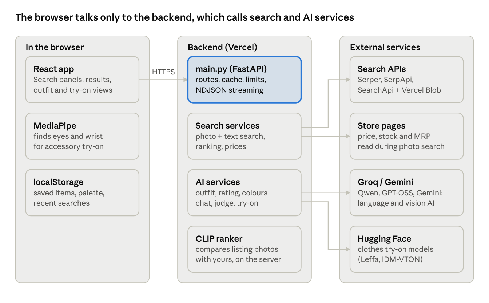

# SnapBuy AI — Project Guide

Oct 22, 2026 · Live version of this guide: [Claude Docs](https://claude.ai/code/artifact/dd30c605-4259-430e-ad88-27b811220527)

SnapBuy AI is a free website that helps people in India shop smarter. You show it a photo or type what you want, and it finds that product in online stores and tells you where it is cheapest.

- **Try it:** [snapbuy-ai.vercel.app](https://snapbuy-ai.vercel.app)
- **Code:** [github.com/itskunalkanaujiya/SnapBuyAI](https://github.com/itskunalkanaujiya/SnapBuyAI)

No sign-up is needed. Anything you save (wishlist, recent searches, your colours, watched prices) stays in your own browser.

## What you can do with it

The home page has one search box and a grid of 10 tools. Each tool does one job.

| Tool | What you give it | What you get back |
| --- | --- | --- |
| Search by photo | A photo of any product | The same product in many stores, cheapest first |
| Describe it | A sentence, typed or spoken ("HP laptop, 8GB RAM, under 50k") | Products that match what you asked for |
| Find the outfit | A photo of a person | Every item they are wearing, each with shopping links |
| Rate my outfit | A photo of your outfit | A score out of 10 and tips to improve it |
| Colours that suit me | A selfie | The colours that look best on you |
| Plan a look on a budget | An occasion and a budget ("wedding, ₹5,000") | A full outfit that fits the budget |
| Find a gift | Who it's for, what they like, a budget | Six gift ideas with shopping links |
| Shop my list | A photo of a shopping list, or a typed one | Every item found, with a total cost |
| Shop a room | A photo of a room | The furniture and decor in it, with links |
| Price watch | Tap the bell on any product | An alert when its price drops |

Some extras work on every result:

- **Compare:** tick 2 or 3 products to see them side by side, with the best pick.
- **Ask AI:** chat about the results ("which one is best for gaming?").
- **Complete the look:** see what goes well with a product.
- **Try on:** see clothes, glasses or a watch on your own photo.
- **Deal check:** each price is marked as a great deal, a fair price or expensive, and fake "70% off" discounts are flagged.

## How it works, in simple words

Every tool follows the same four steps.

1. **You ask.** You give the website a photo or a sentence.
2. **AI understands it.** An AI model looks at the photo or reads the sentence and works out what to search for. For example, from an outfit photo it finds "red silk saree" and "gold jhumka earrings".
3. **We search the stores.** The website searches Google Shopping and Google Lens, which cover Amazon, Flipkart, Myntra, AJIO, Meesho and many more.
4. **We sort and show the results.** Another AI compares each product's picture with yours and keeps the closest ones. Prices are checked, and the results appear on screen one by one, as soon as each is ready.



The project has two parts that talk to each other:

- **Frontend (the website you see):** buttons, search box, results. It runs in your browser.
- **Backend (the server):** does the heavy work. It calls the AI models and the store searches, and keeps the secret keys safe.

## What it is built with

| Part | Tool used | Why |
| --- | --- | --- |
| Website | React + Vite | Builds a fast, modern web page |
| Server | Python + FastAPI | Handles requests and runs the AI steps |
| Understanding photos | Google Gemini (main), Groq (backup) | AI that can look at a photo and describe what's in it |
| Understanding text | Groq (Qwen and GPT-OSS models) | AI that reads sentences, including Hindi and Hinglish |
| Comparing pictures | CLIP | Scores how alike two photos look, from 0 to 1 |
| Store search | Serper, SerpApi, SearchApi | Gives access to Google Shopping and Google Lens |
| Reading store pages | BeautifulSoup | Reads the price, stock and MRP from a store's page |
| Clothes try-on | Hugging Face | Free AI that puts a garment on your photo |
| Glasses and watch try-on | MediaPipe | Finds your eyes or wrist in a photo, inside the browser |
| Hosting | Vercel | Puts the website and server online |
| Testing | pytest | 280 automatic checks that the code works |

Everything runs on free plans of these services.

## Exact models and services

The proper names of every AI model and service, as used in the code.

**AI models**

| Model (exact name) | Provider | Used for |
| --- | --- | --- |
| Gemini 3.5 Flash (`gemini-3.5-flash`) | Google Gemini API | Main vision model: outfit items, outfit rating, colours, rooms, shopping lists |
| Gemini 3.5 Flash-Lite (`gemini-3.5-flash-lite`) | Google Gemini API | Backup Gemini vision model |
| Qwen3.8 27B (`qwen/qwen3.8-27b`) | Groq | Backup vision model; main text model for search sentences, look plans, gifts, chat, compare |
| GPT-OSS 120B (`openai/gpt-oss-120b`) | Groq | Listing judge: checks results are the right item |
| GPT-OSS 20B (`openai/gpt-oss-20b`) | Groq | Backup for the listing judge and text understanding |
| CLIP ViT-B/32 (`openai/clip-vit-base-patch32`; slimmed copy `kunalkanaujiya/clip-vit-base-patch32-vision`) | Hugging Face Transformers + PyTorch | Image similarity: ranks products by how alike they look |
| Leffa (`franciszzj/Leffa`) | Hugging Face Spaces | Clothes try-on (main) |
| IDM-VTON (`yisol/IDM-VTON`) | Hugging Face Spaces | Clothes try-on (backup) |
| MediaPipe Face Landmarker | Google MediaPipe Tasks Vision 1.0.1 | Finds the eyes for glasses try-on, in the browser |
| MediaPipe Hand Landmarker | Google MediaPipe Tasks Vision 1.0.1 | Finds the wrist for watch try-on, in the browser |

**Search and data services**

| Service | Used for |
| --- | --- |
| Serper.dev (Google Shopping API) | Main product search with prices |
| SearchApi.io (Google Lens engine) | Fast search by photo |
| SerpApi (Google Lens and Google Shopping engines) | Backup for photo and text search |
| Vercel Blob | Temporary public link for an uploaded photo, deleted after the search |
| BeautifulSoup | Reads price, stock and MRP from store pages |

**Platforms and frameworks**

| Name | Used for |
| --- | --- |
| Groq API | Runs the Qwen and GPT-OSS models |
| Google AI Studio (Gemini API) | Runs the Gemini models |
| Hugging Face (Transformers, Spaces, ZeroGPU) | CLIP and the try-on models |
| FastAPI + Uvicorn (Python 3.13) | Backend server |
| React 19 + Vite 8 | Frontend website |
| Vercel | Hosts the website and the serverless backend |
| GitHub + GitHub Actions | Code storage and automatic test runs |
| pytest | 280 automated backend tests |
| Web Speech API | Voice search in English and Hindi |
| Browser Notifications API | Price-drop alerts |

The glasses and watch cut-out (removing the product photo's background) is custom code using Pillow and NumPy, not an AI model.

## Where things are in the code

The code has two main folders, one for each part.

```
SnapBuyAI/
├── backend/        The server (Python)
│   ├── main.py                  The front door: every request arrives here
│   ├── image_shopping_service.py  Search by photo
│   ├── text_shopping_service.py   Search by sentence
│   ├── outfit_service.py        Find the outfit, Complete the look
│   ├── style_service.py         Rate my outfit, Colours that suit me
│   ├── planner_service.py       Plan a look on a budget
│   ├── gift_service.py          Find a gift
│   ├── list_service.py          Shop my list
│   ├── room_service.py          Shop a room
│   ├── price_watch_service.py   Price watch
│   ├── assistant_service.py     Ask AI chat and Compare
│   ├── tryon_service.py         Try on
│   └── tests/                   The 280 automatic checks
│
├── frontend/       The website (React)
│   └── src/
│       ├── App.jsx              The main page: decides what to show
│       ├── components/          The pieces you see (search box, cards, tool pages)
│       └── lib/                 The logic behind them (calling the server, deal scores)
│
└── docs/           This guide
```

A simple rule: **one feature, one backend file.** To change how gifts work, open `gift_service.py`.

## How each feature works

**Search by photo.** Your photo goes to Google Lens, which finds similar products online. CLIP then compares each result's picture with yours and labels it "Very close", "Similar" or "Related". The website also opens each store page to read the real price.

**Describe it.** The website reads your sentence and pulls out the important parts: the product, brand, budget and features. It understands Hinglish too ("50k ke andar"). Products over your budget are never shown.

**Find the outfit.** AI looks at the photo from head to toe and lists up to 8 items, with a box around each one. Each item is searched separately, and results are sorted by how much they look like that item in the photo. "Exact match" runs a full photo search on just one item.

**Rate my outfit.** AI scores four things (colours, fit, styling, occasion) and gives an overall score out of 10. It then suggests 2–3 items to improve the look. A second AI, the "listing judge", checks that the shopping results are really the suggested item.

**Colours that suit me.** AI looks at your skin, hair and eye colour and gives you a palette. Products in those colours get a "Suits you" label. Only the palette is saved, never your selfie.

**Plan a look on a budget.** AI plans 3–5 pieces for the occasion and splits the budget between them. If the total goes over budget, pieces are swapped for cheaper options, starting where the most can be saved, until it fits.

**Find a gift.** AI suggests six different gift ideas based on the person and what they like. Each idea is searched, and anything far over the budget is removed.

**Shop my list.** AI reads each line of your list, even handwriting, and searches for every item. It picks a sensibly priced option for each and adds up the total.

**Shop a room.** Works like Find the outfit, but for furniture, lamps, rugs and decor.

**Price watch.** Watched products are saved in your browser. Every 12 hours, when you open the website, their prices are checked again. If a price has dropped, you see a banner and a notification.

**Deal check.** Each price is compared with the typical price of similar products. If a product claims a big discount but costs the same as everywhere else, it is marked "Discount looks inflated".

## Run it on your computer

You need Python 3.13, Node.js 20 or newer, and at least one search key (Serper or SerpApi). Open two terminals.

**Terminal 1 — the server:**

```bash
cd backend
python -m venv ../myvenv
../myvenv/Scripts/activate        # Mac/Linux: source ../myvenv/bin/activate
pip install -r requirements.txt
cp .env.example .env              # then add your own keys to .env
uvicorn main:app --host 127.0.0.1 --port 8000
```

**Terminal 2 — the website:**

```bash
cd frontend
npm install
npm run dev
```

Then open http://127.0.0.1:5173 in your browser.

**Which keys turn on which features** (all go in `backend/.env`):

| Key | Turns on |
| --- | --- |
| `SERPER_API_KEY` or `SERPAPI_API_KEY` | Basic search (required) |
| `SEARCHAPI_API_KEY` + `BLOB_READ_WRITE_TOKEN` | Faster photo search |
| `GROQ_API_KEY` | All AI features |
| `GEMINI_API_KEY` | Faster, more accurate photo understanding |
| `HF_TOKEN` | Clothes try-on |

Never share these keys or put them in the code. The `.env` file is ignored by git, so it never gets uploaded.

## Testing and putting it online

**Before every update, run three checks:**

| Check | Command | What it proves |
| --- | --- | --- |
| Server tests | `cd backend && pytest -q` | All 280 checks pass |
| Code style | `cd frontend && npx eslint src` | No mistakes in the website code |
| Build | `cd frontend && npx vite build` | The website builds without errors |

The tests never use real services or spend any credits; fake versions of the AI and search services are used instead.

**To put a new version online,** push the code to the `main` branch on GitHub. Vercel then updates both the website and the server automatically, in about two minutes. Press Ctrl + Shift + R on the website to see the new version.

| Part | Address |
| --- | --- |
| Website | [snapbuy-ai.vercel.app](https://snapbuy-ai.vercel.app) |
| Server | [snapbuy-ai-api.vercel.app](https://snapbuy-ai-api.vercel.app) |

The secret keys are stored on Vercel as encrypted settings, not in the code.

## Common problems

| What you see | Why | What to do |
| --- | --- | --- |
| "Can't reach the SnapBuy server" | The server isn't running | Start it (Terminal 1 above) |
| "The AI is busy right now" | The free AI limit for this minute is used up | Wait a minute and try again |
| "Try-on is busy" | The free try-on quota for today is used up | Try again tomorrow |
| "Limit reached" | Each visitor gets 10 searches every 10 minutes | Wait a few minutes |
| The first search is slow | The server was asleep and is starting up | Normal; the next ones are fast |
| Changes don't show after an update | The browser kept the old version | Press Ctrl + Shift + R |

## Words explained

| Word | Meaning |
| --- | --- |
| AI model | A program trained to understand photos or text |
| Google Lens | Google's "search with a picture" |
| Google Shopping | Google's list of products and prices from many stores |
| CLIP | An AI that scores how similar two pictures look |
| Gemini, Groq | Services that run AI models; SnapBuy uses their free plans |
| Listing judge | A second AI that double-checks search results are the right item |
| API | The way the website and the server talk to each other |
| API key | A secret password that lets the server use an outside service |
| Frontend / Backend | The website you see / the server doing the work behind it |
| Streaming | Showing results one by one as they are ready, instead of all at the end |
| MRP | Maximum Retail Price, used to check if a discount is real |
| Vercel | The service that hosts the website online |

## For developers: server address list

Every request goes to the server address above (or `http://127.0.0.1:8000` on your computer). A full, clickable list is at `/docs` on the server. Addresses ending in `/stream` send results one by one as they're ready.

| What it does | Address |
| --- | --- |
| Search by photo | `POST /api/v1/products/search-by-image/stream` |
| Search by sentence | `POST /api/v1/products/search-by-text/stream` |
| Find the outfit | `POST /api/v1/outfit/stream` |
| Complete the look | `POST /api/v1/look/stream` |
| Rate my outfit | `POST /api/v1/style/rate/stream` |
| Colours that suit me | `POST /api/v1/style/colours` |
| Plan a look | `POST /api/v1/plan/stream` |
| Find a gift | `POST /api/v1/gifts/stream` |
| Shop my list | `POST /api/v1/list/stream` |
| Shop a room | `POST /api/v1/room/stream` |
| Price watch | `POST /api/v1/prices/check` |
| Compare | `POST /api/v1/compare` |
| Ask AI | `POST /api/v1/assistant` |
| Clothes try-on | `POST /api/v1/tryon` |
| Searches left | `GET /api/v1/usage` |
